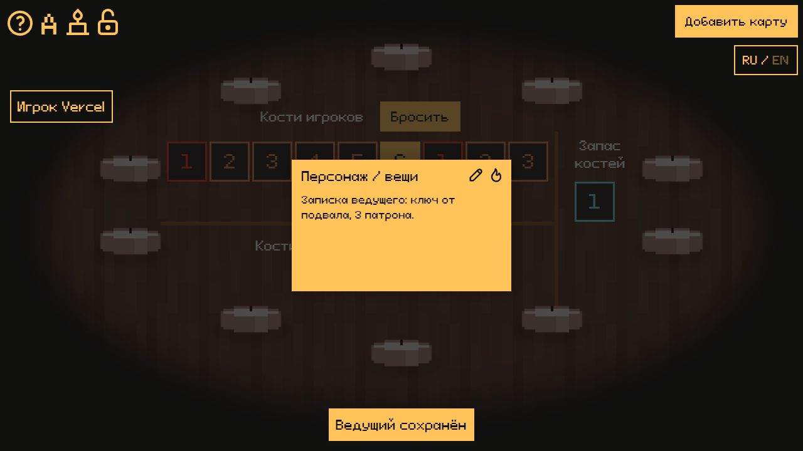

# Десять свечей — русский VTT 1.1.0

Локальный стол для Windows с доступом через интернет и клиентом для Vercel. Основан на исходниках Robyn Choi; оформление и игровые действия сохранены. Русский/английский переключаются кнопкой RU / EN.

## Запуск Windows

Скачайте готовый Windows-архив из [Releases](https://github.com/IkarBogushevich/ten_candles_ru_vtt/releases/latest). В репозитории находятся исходники, переносимый Node.js включён только в архив релиза.

1. Остановите старый запуск. Распакуйте новый архив в отдельную папку.
2. Запустите **СТАРТ-ИНТЕРНЕТ.bat**, дождитесь сообщения «ССЫЛКА ПРОВЕРЕНА».
3. На открывшемся сайте создайте комнату, отправьте друзьям полный адрес `/room/...`.
4. Для работы игры оставьте ПК и окно запуска включёнными. Ctrl+C останавливает процессы этого окна.

Установка Node.js и npm-пакетов для игры не требуется — runtime включён. Основной туннель localhost.run использует встроенный Windows OpenSSH. `СТАРТ-CLOUDFLARE.bat` — резерв, `СТАРТ-ЛОКАЛЬНО.bat` — только этот компьютер. Порт 3020; сервер слушает 127.0.0.1. Входящие порты роутера открывать не нужно.

## Исправления 1.1.0

- F5 и повторное открытие ссылки комнаты возвращают прежнего участника без повторного ввода имени. Кнопка «Вернуться в мою комнату» на стартовом экране открывает последнюю комнату.
- Ведущий больше не удаляется при отключении. Его роль сохраняется, даже если в комнате остаются игроки. Другой участник не получает её автоматически. Передача роли вручную остаётся доступна.
- Личное место защищено случайным ключом, сохранённым в браузере. Одного имени или ID недостаточно для захвата ведущего. Сервер хранит только хеш ключа.
- Карты и записки (содержимое карт) автоматически сохраняются после создания, изменения, сжигания и передачи. Есть копия в браузере и на сервере. Восстанавливаются порядок, раскрытая Грань и карточка персонажа с вещами.
- `data/rooms-v1.json` сохраняет участников, роли, карты, свечи, кости и блокировку. Перезапуск сервера с той же папкой `data` восстанавливает игру. Свечи учитывают прошедшее реальное время, включая простой сервера.
- Клиент для Vercel и инструкция — **VERCEL.md**. Серверные комнаты обслуживаются отдельным постоянным сервером; самостоятельное размещение всей серверной части в Vercel Functions не реализовано.

Браузерное хранилище привязано к домену и браузеру. Удаление данных сайта, приватный режим, смена устройства или домена не переносят вход автоматически. Для постоянного адреса клиента подходит Vercel; бесплатный туннель может менять серверный домен. Одинаковый домен клиента и прежняя папка `data` сохраняют сессии при смене адреса серверной части.

Сессии до 1.1.0 не сохранялись. Уже потерянную старую учётку восстановить задним числом невозможно. Обновляйтесь между партиями. В новых версиях переносите свою папку `data` при остановленном сервере; не запускайте два сервера с одной папкой данных. Карты и личные ключи не входят в выпускаемый архив. Очистка сохранений по окончании игры пока выполняется вручную; автоматически данные не удаляются.

## Что сохранено из 1.0.2

Координаты зон костей и разделителей не зависят от языка. PNG свечей не вытаскиваются мышью; игровые кости и карты перетаскиваются. Свечи постепенно уменьшаются при горении, гашение ставит расход воска на паузу. Ведущий может настроить время полной свечи (исходно 3 часа 30 минут); новые параметры применяются при следующем зажигании. После полного сгорания клик создаёт новую свечу. Ограничения оригинального интерфейса на маленьких экранах сохранены.

## Проверка и разработка

Node.js 22+. Сборка: `npm.cmd ci` и `npm.cmd run build` отдельно в `client` и `server`. Проверка: `node test.mjs` из корня после сборки и установки клиентских зависимостей. Тест запускает отдельный сервер с собственной папкой данных, проверяет перезапуск и останавливает свои процессы. Рабочие комнаты не изменяет.

Проверены: возврат ведущего и игрока, запрет входа с чужим ключом, сохранение записок, передача карты без дубликата, броски и перемещение костей, замок, свечи, CORS, восстановление с диска после рестарта. В браузере создана записка ведущего, выполнен F5, записка и кнопки ведущего восстановились. Отдельно проверяется сборка для другого адреса сервера. Публикация в аккаунте Vercel и реальная партия с друзьями не выполнялись.

Оригиналы: https://github.com/robyn3choi/tencandles-vtt (0f428cae5479c8e207a3b8ffd307dc129effc8f3), https://github.com/robyn3choi/tencandles-vtt-server (f7bef06e70ffbed7214877da4418cc7d7f969047). Игра — Stephen Dewey, https://cavalrygames.com/ten-candles-info.

Дополнительная проверка 1.1.0: клиент с origin 127.0.0.1:3044 подключился к серверу 127.0.0.1:3033. После F5 игрок автоматически вернулся без прав ведущего, его записка восстановилась. Затем ведущий обновил страницу при присутствующем игроке: роль и записка остались у него. Скриншоты: qa/gm-restored-1.1.0.png и qa/player-restored-1.1.0.png. Это локальная проверка двух разных origin, не публикация в Vercel.

## Проверка восстановления ведущего

